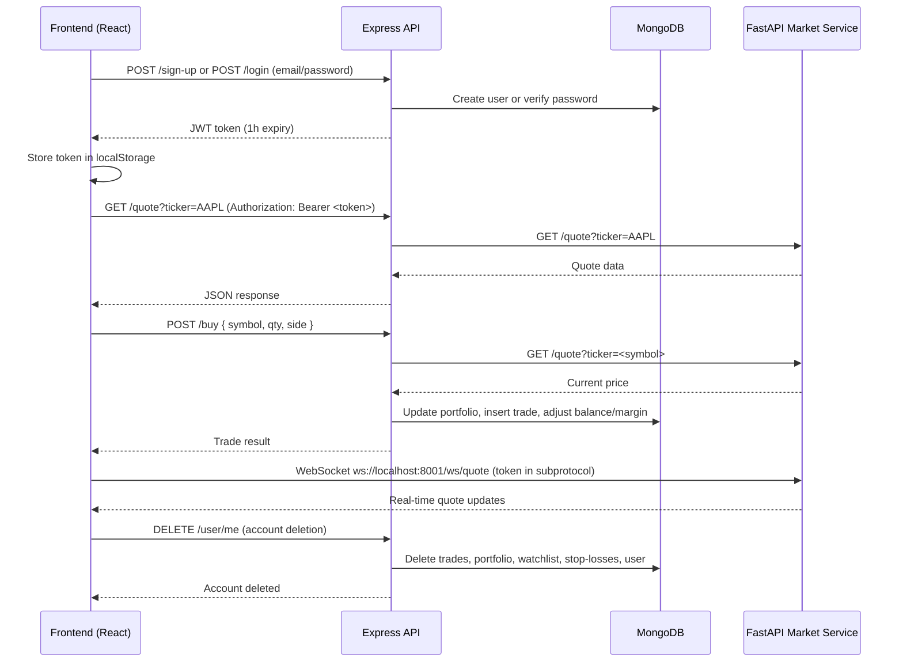

# Architecture

One-sentence purpose: Describes the system architecture, tech stack, folder structure, and request flow of the Paper Trading App.

## What the App Is

A paper trading platform where users can trade stocks with virtual money. Features include email/password and Google OAuth authentication, real-time market data via WebSocket, portfolio tracking, stop-loss orders, watchlists, trade history, and push notifications.

## Tech Stack

| Layer | Technology | Purpose |
|-------|-----------|---------|
| Frontend | React 19, TypeScript, Vite, Tailwind CSS 4 | UI client dashboard |
| Frontend state | React Context, React Router DOM | Routing and context providers |
| Frontend HTTP | Axios | API client with auth token interceptor |
| Frontend charts | lightweight-charts | Candlestick charting |
| Backend | Express 5, TypeScript | REST API server |
| Database | MongoDB, Mongoose | User, portfolio, trades, watchlist, stop-loss data |
| Auth | JWT (jsonwebtoken), bcrypt, Google OAuth | Session tokens, password hashing, social login |
| Market data | Python FastAPI, Yahoo Finance (yfinance) | Real-time quotes, OHLCV, indicators, ticker search |
| WebSocket | ws (backend), WebSocket API (frontend) | Real-time quote and indicator streaming |
| Push notifications | web-push | Stop-loss execution notifications |
| Validation | Zod | Request/response schemas shared between frontend and backend |
| Lint/format | ESLint, Prettier | Code quality and formatting |

## Folder Structure

```text
/ (repo root)
├── server/                # Express backend (TypeScript)
│   ├── server.ts          # App entry point, route definitions, global error handler
│   ├── queryManager.ts    # Business logic: auth, trades, portfolio, watchlist, stop-loss, user deletion
│   ├── Schemas/mongoSchema.ts  # Mongoose schemas: User, Watchlist, Portfolio, Trade, StopLoss
│   ├── lib/
│   │   ├── env.ts         # Zod-validated env config
│   │   ├── route.ts       # Zod-validated route wrapper with auth
│   │   ├── auth.ts        # JWT verify + authMiddleware
│   │   ├── googleAuth.ts  # Google OAuth start/callback handlers
│   │   └── pythonClient.ts# Axios client for FastAPI market data service
│   ├── Services/notificationService.ts  # Web Push notifications
│   ├── StopLoss/
│   │   ├── stoploss.ts    # WebSocket client to FastAPI, executes stop-losses
│   │   └── getAllStopLoss.ts  # Loads stop-losses into memory map
│   ├── GetData/getQuote.ts
│   ├── express.dockerfile
│   └── .env               # Local secrets (gitignored)
├── src/                   # React frontend (TypeScript)
│   ├── App.tsx            # Root app: push subscription, WebSocket connections
│   ├── main.tsx           # React entry point with BrowserRouter
│   ├── routes/AppRouter.tsx   # Route definitions (public + protected)
│   ├── routes/protectedRoutes.tsx   # Token-based route guard
│   ├── routes/checkTokenExpiry.ts   # JWT expiry check helper
│   ├── pages/             # Page components: login, signup, landingPage, stockChart, portfolioPage, userProfile, market
│   ├── Components/        # Reusable UI: Navbar, OrderForm, PasswordInput, Watchlist, charts, toasts
│   ├── Context/           # React context providers: UserAccount, UserEquity, Watchlist, MarketData, IndicatorsList
│   ├── lib/               # wsManager (WebSocket reconnect manager), formatters, useTicker hook
│   ├── services/          # API client wrappers: api.ts, placeOrder, tradeHistory, watchlist, dataRequesterForCharts
│   └── index.css          # Tailwind + theme tokens
├── shared/                # Shared contracts between frontend and backend
│   ├── contract/
│   │   ├── define.ts      # EndpointDefinition Zod helper
│   │   ├── auth.ts        # Signup, login, user-data, subscription, delete-account schemas
│   │   ├── trade.ts       # Buy, sell, stop-loss, trade-history, portfolio schemas
│   │   ├── watchlist.ts   # Watchlist get/add/delete schemas
│   │   ├── market.ts      # Quote, data, search, indicator schemas
│   │   ├── push.ts        # Push subscription schema
│   │   └── wsMessages.ts  # WebSocket message types
│   ├── ws/messages.ts
│   └── index.ts           # Re-exports all contracts
├── YahooFinanceDataPipeline/  # Python FastAPI market data service
├── .env.example           # Template for required environment variables
├── .env                   # Local secrets (gitignored)
├── package.json           # Root scripts and dependencies
├── vite.config.ts         # Vite config with /api proxy to localhost:3001
├── tsconfig.*.json        # TypeScript project references (app, server, node)
├── eslint.config.js       # ESLint flat config
└── .prettierrc.json       # Prettier config
```

## Request Flow Example



## External Services

- **Google OAuth:** Users can sign in with Google. The backend redirects to Google's consent screen, receives an authorization code, exchanges it for tokens, finds or creates a local user, issues a JWT, and redirects back to the frontend with the token in the query string.
- **FastAPI Market Data Service:** Runs on port 8000 (HTTP) and 8001 (WebSocket). Provides quotes, OHLCV data, technical indicators, and ticker search via Yahoo Finance.
- **MongoDB Atlas:** Cloud-hosted MongoDB instance for persistence.

---

**Last verified against code:** `server/server.ts`, `server/queryManager.ts`, `server/Schemas/mongoSchema.ts`, `src/AppRouter.tsx`, `src/services/api.ts`, `shared/contract/`, `vite.config.ts`.