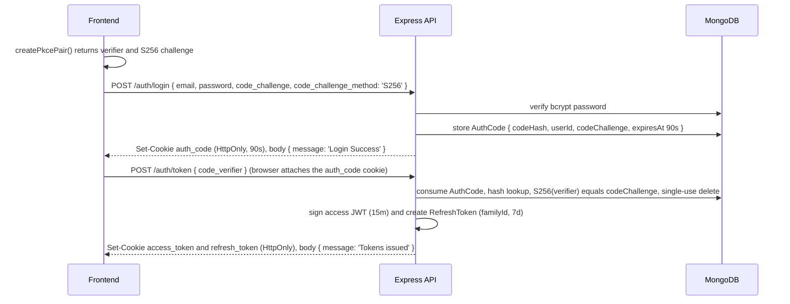
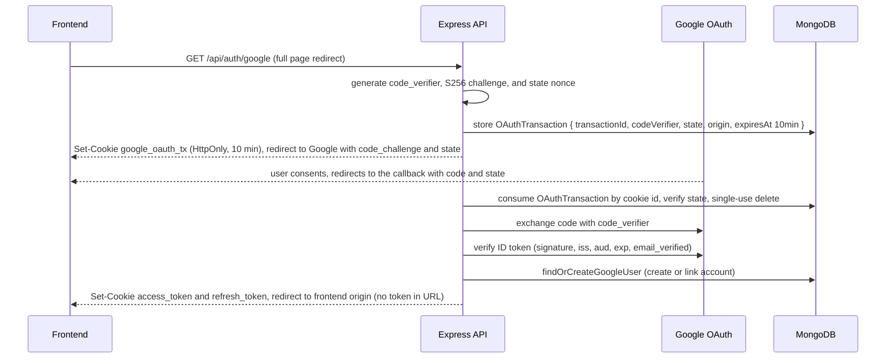

# Authentication

One-sentence purpose: Describes how authentication works in the Paper Trading App — PKCE email/password login, Google OAuth with server-side PKCE, HttpOnly cookie sessions, refresh rotation, middleware, logout, and account deletion.

## Overview

Authentication is **cookie-based**. After login, the server sets two HttpOnly cookies and the frontend never handles a token directly:

- `access_token` — JWT signed with `JWT_SECRET`, 15-minute expiry, `path=/`
- `refresh_token` — opaque UUID, 7-day expiry, `path=/auth` (only sent to `/auth/*`)

No token is stored in `localStorage`, returned in a response body, or placed in a URL. The browser attaches the cookies automatically because all frontend requests use `credentials: 'include'` / `withCredentials: true`.

## Email/Password Login (PKCE, RFC 7636 — S256 only)

Two-step authorization-code flow with PKCE. The frontend generates the verifier/challenge with WebCrypto (`src/lib/pkce.ts`: `createPkcePair()`).

### Endpoints

- `POST /auth/login` (public) — body `{ email, password, code_challenge (43–128 chars), code_challenge_method: 'S256' }`. Validates credentials (bcrypt, salt 10). Google-only accounts (no `passwordHash`) get a 400 directing them to Google sign-in. On success creates a one-time `AuthCode` (hashed, 90-second TTL) bound to the user and the `code_challenge`, and sets it as an **HttpOnly `auth_code` cookie** (`path=/auth`, 90s) — the code is never in the response body, so frontend JS cannot read it. Response: `{ message: 'Login Success' }`.
- `POST /auth/token` (public) — body `{ code_verifier (43–128 chars) }`; the code comes from the `auth_code` cookie, which the browser attaches automatically. The server clears the `auth_code` cookie on every attempt (single-use) and consumes the code: SHA-256 hash lookup, `base64url(SHA-256(verifier))` must equal the stored challenge, expiry check, then the code is deleted. Wrong verifier → 401 `code_verifier does not match the authorization code`. On success issues the session cookies. Response body contains **no tokens**: `{ message: 'Tokens issued' }`.
- `POST /auth/refresh` (public, but requires the `refresh_token` cookie) — rotates the refresh token: the presented token is revoked and a new one is issued in the same `familyId`. **Reuse detection:** presenting a revoked token revokes the entire family and returns 401 — except within a 30-second grace window of its revocation, which tolerates concurrent refreshes from multiple open tabs (logout sets `familyRevoked`, so logged-out families can never be revived). Sets fresh `access_token` + `refresh_token` cookies. Response: `{ message: 'Token refreshed' }`.
- `POST /auth/logout` (public) — revokes the presented refresh token's family and clears both cookies. Response: `{ message: 'Logged out' }`.
- `POST /auth/ws-ticket` (protected by the `access_token` cookie) — returns `{ ticket }`, a 5-minute JWT with a `scope: 'ws'` claim. Used only to authenticate the market-data WebSocket handshake (see below). The ticket is rejected as an API access token.

Schemas: `loginPkceEndpoint`, `tokenExchangeEndpoint`, `refreshEndpoint`, `logoutEndpoint`, `wsTicketEndpoint` in `shared/contract/auth.ts`. Logic: `server/lib/pkce.ts`, `server/lib/authStore.ts`, `server/lib/session.ts`.

## Google OAuth (server-side PKCE + state)

- `GET /api/auth/google` — starts the flow. The PKCE verifier, state and callback URL live **server-side** in an `OAuthTransaction` document; the browser only gets an opaque `google_oauth_tx` cookie. Redirects to Google's consent screen with `code_challenge` (S256), `state`, and a `redirect_uri` derived from the request's own origin (the host of `GOOGLE_CALLBACK_URL` swapped for the allowlisted Referer origin, keeping its path). The login button navigates to `/api/auth/google` **same-origin** (Vite proxy), so the callback lands on the exact host the user is browsing — cookies are host-specific, so `localhost` and `127.0.0.1` each need their own registered callback URI and their own session; a callback on `localhost:3001` would never be sent to a tab on `localhost:5173` or `127.0.0.1:5173`.
- `GET /api/auth/google/callback` — consumes the transaction (state match, single-use), exchanges the code **with the code_verifier and the stored `redirect_uri`** (Google requires an exact match with the authorization request), verifies the ID token (issuer allowlist `accounts.google.com`, audience = `GOOGLE_CLIENT_ID`, expiry, `email_verified`), finds or creates the user, issues the session cookies on the callback host, and redirects to the stored origin with **no query params**. Failures redirect to `<origin>/?error=google_failed`.
- Account linking: if the Google email matches an existing local account, `googleId` and `authProvider: 'google'` are set on it. Google-only users have no `passwordHash`.

## Cookie Details

| Cookie | Purpose | httpOnly | sameSite | secure | path | maxAge |
|--------|---------|----------|----------|--------|------|--------|
| `access_token` | Session JWT (15 min) | Yes | lax | production only | `/` | 15 minutes |
| `refresh_token` | Refresh token (7 days) | Yes | lax | production only | `/auth` | 7 days |
| `auth_code` | One-time PKCE authorization code | Yes | lax | production only | `/auth` | 90 seconds |
| `google_oauth_tx` | Opaque OAuth transaction id | Yes | lax | production only | `/` | 10 minutes |

Options are centralized in `server/lib/cookies.ts` (`accessTokenCookieOptions`, `refreshTokenCookieOptions`, `authCodeCookieOptions`, `pkceCookieOptions`, `clearCookieOptions`). Clearing uses matching attributes so the browser actually removes the cookie.

## Protected Route Middleware

- `verifyToken(req)` in `server/lib/auth.ts` reads the `access_token` cookie via the type-safe `getCookie()` helper, verifies the JWT with `jwt.verify`, rejects tokens carrying a `scope` claim (WS tickets), and parses the payload with `jwtPayloadSchema` (`{ userId, email }`).
- The `route()` wrapper in `server/lib/route.ts` checks `endpoint.auth`; if true it calls `verifyToken` and passes `{ userId, email }` as `user` to the handler.
- Missing/invalid/expired cookie → `UnauthorizedError` (401) with messages `No token provided` / `Invalid token` / `Token expired`.

## CSRF and Rate Limiting

- `csrfMiddleware` (`server/lib/csrf.ts`) enforces an Origin/Referer allowlist (`buildAllowedOrigins()` from `FRONTEND_URL`, `VITE_API_BASE_URL`, `PRODUCTION_FRONTEND_URL` in production, plus localhost ports in dev) on all state-changing requests (POST/PUT/PATCH/DELETE). Needed because SameSite=Lax cookies do not fully protect cross-site POSTs.
- `rateLimit` (`server/lib/rateLimit.ts`) — in-memory fixed-window limiter applied to `/auth/*` (30 req/min) and `/api/auth/google` (20 req/min).
- CORS (`server/server.ts`) uses the same explicit origin allowlist with `credentials: true` — no wildcard.

## Frontend Auth

- `src/services/auth.ts` — `loginWithPkce(email, password)`: creates a PKCE pair (`src/lib/pkce.ts`, WebCrypto `getRandomValues` + `crypto.subtle`), POSTs `/auth/login` then `/auth/token`, both with `credentials: 'include'`. The one-time code travels only in the HttpOnly `auth_code` cookie (set by `/auth/login`, attached automatically to `/auth/token`), so the frontend never handles it; `/auth/token` sends only `code_verifier`. `fetchWsTicket()` POSTs `/auth/ws-ticket` with cookie credentials.
- `src/services/api.ts` — Axios instance with `withCredentials: true`. Response interceptor: on 401 (except `/auth/refresh` and `/auth/logout`), calls `POST /auth/refresh` once (deduplicated via a shared promise), retries the original request; if refresh fails, redirects to `/` when not already on `/` or `/signup`.
- `src/pages/login.tsx` / `signup.tsx` — on mount, check the session via `fetchUserData()` (the api client), so an expired `access_token` is refreshed automatically from the `refresh_token` cookie and the user is redirected to `/landing-page` without logging in again — this is what restores the session after closing and reopening the browser or opening a second window. The check retries up to 3 times (2s apart) so a transient failure (e.g. a rate-limited refresh) cannot leave the user stuck on the login form. Login itself uses `loginWithPkce` / `POST /sign-up` with `credentials: 'include'`; the login page also surfaces `?error=google_failed`.
- `src/services/dataRequesterForCharts.ts` — chart data calls (`/data`, `/quote`, `/data/indicator`) use `withCredentials: true`; no Authorization header.
- `src/routes/protectedRoutes.tsx` — on mount, calls `GET /user-data`; renders a loading state while checking, `<Outlet/>` if authenticated, `<Navigate to="/">` otherwise.
- WebSocket auth: `src/App.tsx` passes `getToken: fetchWsTicket` to `wsManager.connect(...)`; `src/lib/wsManager.ts` fetches a **fresh** ticket before every (re)connect and sends it as the WebSocket subprotocol (the Python market-data server verifies it with the shared `JWT_SECRET`). While no ticket can be fetched (e.g. logged out), no connection is attempted and the retry is backed off to 30s; failed connects use **exponential backoff** (doubling up to 60s, reset on a successful open) — this prevents 403/429 retry spam against the WS and auth endpoints. The HttpOnly cookie cannot be read by JS, hence the ticket.

## Logout

- Frontend: `POST /auth/logout` (cookie credentials), then navigate to `/`. The server revokes the refresh-token family and clears both cookies.

## Delete Account

- Endpoint: `DELETE /user/me` (protected)
- Revokes all refresh tokens and outstanding auth codes for the user, then deletes all associated data in a transaction: trades, portfolio, watchlist, stop-losses, then the user document.
- Frontend (`src/pages/userProfile.tsx`): requires typing "DELETE" to confirm.

---

**Open Questions / Known Gaps**

- No email verification flow for email/password signups.
- Password reset / forgot password is not implemented.
- The in-memory rate limiter is per-process; a multi-instance deployment would need a shared store.

---

**Last verified against code:** `server/server.ts`, `server/lib/auth.ts`, `server/lib/authStore.ts`, `server/lib/session.ts`, `server/lib/cookies.ts`, `server/lib/pkce.ts`, `server/lib/googleAuth.ts`, `server/lib/csrf.ts`, `server/lib/rateLimit.ts`, `server/lib/route.ts`, `server/Schemas/mongoSchema.ts`, `shared/contract/auth.ts`, `src/services/auth.ts`, `src/services/api.ts`, `src/services/dataRequesterForCharts.ts`, `src/lib/pkce.ts`, `src/lib/wsManager.ts`, `src/routes/protectedRoutes.tsx`, `src/pages/login.tsx`, `src/pages/signup.tsx`, `src/pages/userProfile.tsx`, `src/App.tsx`.
