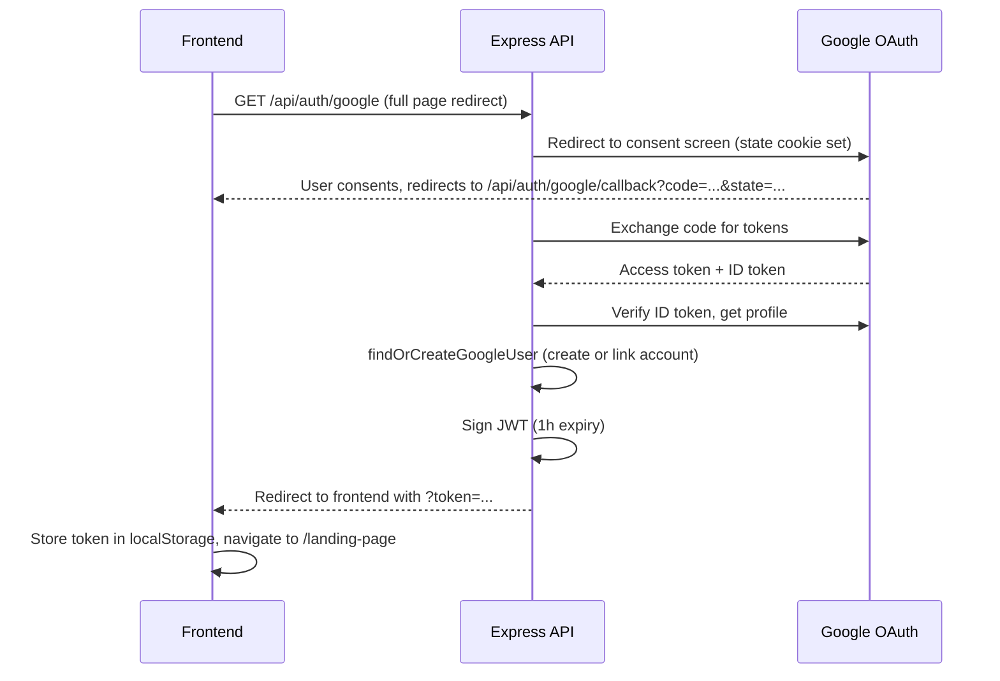

# Authentication

One-sentence purpose: Describes how authentication works in the Paper Trading App — email/password login, Google OAuth, cookies, middleware, logout, and account deletion.

## Email/Password Login

### Sign Up
- Endpoint: `POST /sign-up` (public)
- Body: `{ email, password, username }`
- Password is hashed with bcrypt (salt rounds: 10) and stored as `passwordHash` on the `User` model.
- Default starting balance: 1,000,000.
- `authProvider` defaults to `'local'`.

### Login
- Endpoint: `POST /login` (public)
- Body: `{ email, password }`
- Looks up user by email. If `passwordHash` is missing (Google-only account), returns a 400 error directing the user to sign in with Google.
- Compares password with bcrypt.
- On success, signs a JWT with `{ userId, email }`, expires in 1 hour, using `JWT_SECRET`.
- Response: `{ message: 'Login Success', token }`.
- The frontend stores the token in `localStorage` under key `token`.

## Google OAuth

### Flow

### Endpoints
- `GET /api/auth/google` — Starts OAuth flow. Sets httpOnly cookies `google_oauth_state` (CSRF protection, 10 min) and `google_oauth_origin` (redirect origin). Redirects to Google.
- `GET /api/auth/google/callback` — Handles Google's response. Verifies state cookie, exchanges code for tokens, verifies ID token, finds or creates user, issues JWT, redirects to frontend with token in query param.

### Account Linking
- If a Google user's email matches an existing local (email/password) account, the accounts are linked: `googleId` and `authProvider: 'google'` are set on the existing user.
- If no match exists, a new user is created with a generated username.
- Google-only users have no `passwordHash` and cannot log in with email/password.

## Cookie Details

| Cookie | Purpose | httpOnly | sameSite | secure | maxAge |
|--------|---------|----------|----------|--------|--------|
| `google_oauth_state` | CSRF protection for OAuth | Yes | lax | production only | 10 minutes |
| `google_oauth_origin` | Redirect origin after OAuth | Yes | lax | production only | 10 minutes |

JWTs are **not** stored in cookies. They are stored in `localStorage` on the frontend and sent as `Authorization: Bearer <token>` headers.

## Protected Route Middleware

- `verifyToken(req)` in `server/lib/auth.ts` reads the `Authorization: Bearer <token>` header, verifies the JWT with `jwt.verify`, and parses the payload with `jwtPayloadSchema` (`{ userId: string, email: string }`).
- `authMiddleware(req, res, next)` calls `verifyToken` and attaches `req.user`.
- The `route()` wrapper in `server/lib/route.ts` checks `endpoint.auth`. If true, it calls `verifyToken` and passes `{ userId, email }` as the `user` field to the handler.
- If no token or invalid token, throws `UnauthorizedError` (401).

## Frontend Auth Guard

- `src/routes/protectedRoutes.tsx`: Checks `localStorage.getItem('token')` and `isTokenExpired(token)`. If missing or expired, redirects to `/`.
- `src/services/api.ts`: Axios request interceptor adds `Authorization: Bearer <token>` from `localStorage`. Response interceptor: on 401, removes token and redirects to `/` unless already on `/` or `/signup`.
- `src/routes/checkTokenExpiry.ts`: Decodes JWT payload and checks `exp` timestamp.

## Logout

- Frontend: `localStorage.removeItem('token')`, then navigate to `/`.
- No server-side logout endpoint (JWT is stateless).

## Delete Account

- Endpoint: `DELETE /user/me` (protected)
- Deletes all associated data in a transaction: trades, portfolio, watchlist, stop-losses, then the user document.
- Frontend (`src/pages/userProfile.tsx`): Requires typing "DELETE" to confirm, sends `Authorization: Bearer <token>` header, removes token on success.

---

**Open Questions / Known Gaps**

- JWT expiration is 1 hour. There is no refresh token mechanism; users must re-login after expiry.
- The frontend stores the token in `localStorage`, which is vulnerable to XSS. The [security.md](./security.md) rule says never store tokens in localStorage, but the current code does.
- No email verification flow for email/password signups.
- Password reset / forgot password is not implemented.

---

**Last verified against code:** `server/queryManager.ts`, `server/lib/auth.ts`, `server/lib/googleAuth.ts`, `server/lib/route.ts`, `server/Schemas/mongoSchema.ts`, `src/services/api.ts`, `src/routes/protectedRoutes.tsx`, `src/pages/userProfile.tsx`, `src/pages/login.tsx`, `src/pages/signup.tsx`.