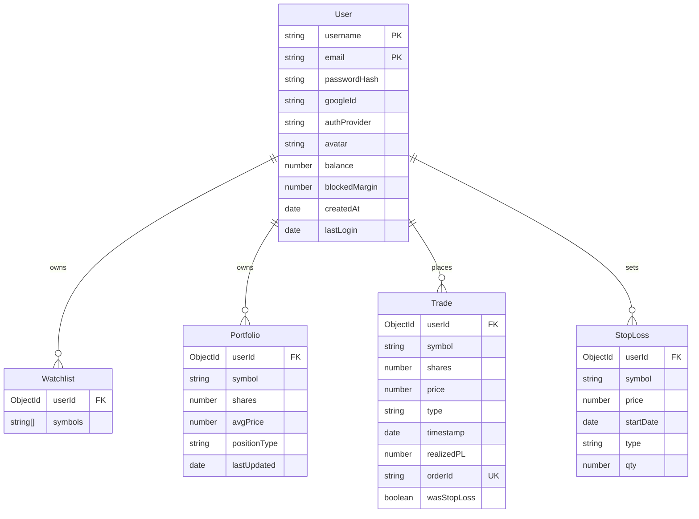

# Database

One-sentence purpose: Documents every MongoDB model/collection, its fields, types, constraints, indexes, relationships, defaults, and the ER diagram.

## Models

All models are defined in `server/Schemas/mongoSchema.ts` using Mongoose. `{ timestamps: false }` is set on all schemas (no automatic `createdAt`/`updatedAt`).

### User

| Field | Type | Required | Default | Constraints |
|-------|------|----------|---------|-------------|
| `username` | String | Yes | — | unique |
| `email` | String | Yes | — | unique |
| `passwordHash` | String | No | — | Optional for Google-only users |
| `googleId` | String | No | — | unique, sparse |
| `authProvider` | String | No | `'local'` | enum: `['local', 'google']` |
| `avatar` | String | No | — | — |
| `balance` | Number | No | `1_000_000` | — |
| `blockedMargin` | Number | No | `0` | — |
| `createdAt` | Date | No | `Date.now()` | — |
| `lastLogin` | Date | No | — | — |
| `notificationSubscription` | Object | No | — | Nested: `{ endpoint, expirationTime, keys: { p256dh, auth } }` |

### Watchlist

| Field | Type | Required | Default | Constraints |
|-------|------|----------|---------|-------------|
| `userId` | ObjectId | Yes | — | ref: 'User' |
| `symbols` | [String] | Yes | `[]` | — |

### Portfolio

| Field | Type | Required | Default | Constraints |
|-------|------|----------|---------|-------------|
| `userId` | ObjectId | Yes | — | ref: 'User' |
| `symbol` | String | Yes | — | — |
| `shares` | Number | Yes | — | — |
| `avgPrice` | Number | Yes | — | — |
| `positionType` | String | No | — | enum: `['long', 'short']` |
| `lastUpdated` | Date | No | `Date.now()` | — |

### Trade

| Field | Type | Required | Default | Constraints |
|-------|------|----------|---------|-------------|
| `userId` | ObjectId | Yes | — | ref: 'User' |
| `symbol` | String | Yes | — | — |
| `shares` | Number | Yes | — | — |
| `price` | Number | Yes | — | — |
| `type` | String | Yes | — | enum: `['buy', 'sell']` |
| `timestamp` | Date | No | `Date.now()` | — |
| `realizedPL` | Number | Yes | — | — |
| `orderId` | String | Yes | — | unique |
| `wasStopLoss` | Boolean | No | `false` | — |

### StopLoss

| Field | Type | Required | Default | Constraints |
|-------|------|----------|---------|-------------|
| `userId` | ObjectId | Yes | — | ref: 'User' |
| `symbol` | String | Yes | — | — |
| `price` | Number | Yes | — | — |
| `startDate` | Date | No | `Date.now()` | — |
| `type` | String | Yes | — | enum: `['buy', 'sell']` |
| `qty` | Number | Yes | — | — |

## ER Diagram

## Data Deleted on User Deletion

When a user is deleted via `DELETE /user/me` (implemented in `deleteUser` in `server/queryManager.ts`), the following are deleted in a MongoDB transaction:

1. All `Trade` documents with `userId` matching the user.
2. All `Portfolio` documents with `userId` matching the user.
3. All `Watchlist` documents with `userId` matching the user.
4. All `StopLoss` documents with `userId` matching the user.
5. The `User` document itself.

If the user is not found, a 404 error is thrown.

---

**Last verified against code:** `server/Schemas/mongoSchema.ts`, `server/queryManager.ts` (`deleteUser` function).