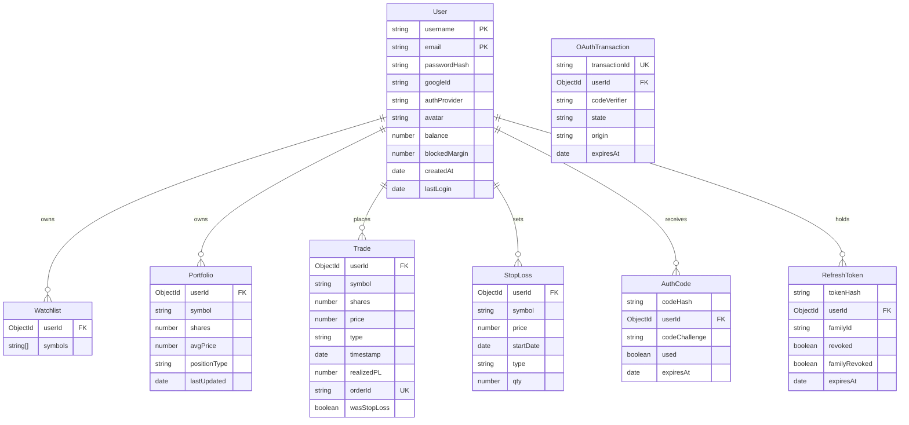

# Database

One-sentence purpose: Documents every MongoDB model/collection, its fields, types, constraints, indexes, relationships, defaults, and the ER diagram.

## Models

All models are defined in `server/Schemas/mongoSchema.ts` using Mongoose. `{ timestamps: false }` is set on all schemas (no automatic `createdAt`/`updatedAt`).

### User

| Field | Type | Required | Default | Constraints |
|-------|------|----------|---------|-------------|
| `username` | String | Yes | — | unique |
| `email` | String | Yes | — | unique |
| `passwordHash` | String | No | — | Optional for Google-only users |
| `googleId` | String | No | — | unique, sparse |
| `authProvider` | String | No | `'local'` | enum: `['local', 'google']` |
| `avatar` | String | No | — | — |
| `balance` | Number | No | `1_000_000` | — |
| `blockedMargin` | Number | No | `0` | — |
| `createdAt` | Date | No | `Date.now()` | — |
| `lastLogin` | Date | No | — | — |
| `notificationSubscription` | Object | No | — | Nested: `{ endpoint, expirationTime, keys: { p256dh, auth } }` |

### Watchlist

| Field | Type | Required | Default | Constraints |
|-------|------|----------|---------|-------------|
| `userId` | ObjectId | Yes | — | ref: 'User' |
| `symbols` | [String] | Yes | `[]` | — |

### Portfolio

| Field | Type | Required | Default | Constraints |
|-------|------|----------|---------|-------------|
| `userId` | ObjectId | Yes | — | ref: 'User' |
| `symbol` | String | Yes | — | — |
| `shares` | Number | Yes | — | — |
| `avgPrice` | Number | Yes | — | — |
| `positionType` | String | No | — | enum: `['long', 'short']` |
| `lastUpdated` | Date | No | `Date.now()` | — |

### Trade

| Field | Type | Required | Default | Constraints |
|-------|------|----------|---------|-------------|
| `userId` | ObjectId | Yes | — | ref: 'User' |
| `symbol` | String | Yes | — | — |
| `shares` | Number | Yes | — | — |
| `price` | Number | Yes | — | — |
| `type` | String | Yes | — | enum: `['buy', 'sell']` |
| `timestamp` | Date | No | `Date.now()` | — |
| `realizedPL` | Number | Yes | — | — |
| `orderId` | String | Yes | — | unique |
| `wasStopLoss` | Boolean | No | `false` | — |

### StopLoss

| Field | Type | Required | Default | Constraints |
|-------|------|----------|---------|-------------|
| `userId` | ObjectId | Yes | — | ref: 'User' |
| `symbol` | String | Yes | — | — |
| `price` | Number | Yes | — | — |
| `startDate` | Date | No | `Date.now()` | — |
| `type` | String | Yes | — | enum: `['buy', 'sell']` |
| `qty` | Number | Yes | — | — |

### AuthCode (PKCE login, step 1)

One-time authorization codes issued by `POST /auth/login`. Only the SHA-256 hash of the code is stored.

| Field | Type | Required | Default | Constraints |
|-------|------|----------|---------|-------------|
| `codeHash` | String | Yes | — | SHA-256 hex of the code |
| `userId` | ObjectId | Yes | — | ref: 'User' |
| `codeChallenge` | String | Yes | — | PKCE S256 challenge the code is bound to |
| `used` | Boolean | No | `false` | Single-use: the document is deleted on first successful exchange |
| `expiresAt` | Date | Yes | — | TTL index (`expires: 0`); set to +90 seconds |

### RefreshToken

Session refresh tokens delivered as the HttpOnly `refresh_token` cookie. Only the SHA-256 hash is stored.

| Field | Type | Required | Default | Constraints |
|-------|------|----------|---------|-------------|
| `tokenHash` | String | Yes | — | SHA-256 hex of the token |
| `userId` | ObjectId | Yes | — | ref: 'User' |
| `familyId` | String | Yes | — | indexed; all rotations of one login share it |
| `revoked` | Boolean | No | `false` | set on rotation/logout |
| `revokedAt` | Date | No | `null` | when the token was revoked; drives the 30s multi-tab rotation grace window |
| `familyRevoked` | Boolean | No | `false` | set when a revoked token is reused after the grace window, or on logout |
| `expiresAt` | Date | Yes | — | TTL index (`expires: 0`); set to +7 days |

### OAuthTransaction

Server-side state for the Google OAuth + PKCE flow. The browser only holds the opaque `transactionId` in the `google_oauth_tx` cookie.

| Field | Type | Required | Default | Constraints |
|-------|------|----------|---------|-------------|
| `transactionId` | String | Yes | — | unique |
| `userId` | ObjectId | No | — | ref: 'User' |
| `codeVerifier` | String | Yes | — | PKCE verifier, kept server-side only |
| `state` | String | Yes | — | CSRF nonce, compared on callback |
| `origin` | String | Yes | — | frontend origin to redirect to after the flow |
| `expiresAt` | Date | Yes | — | TTL index (`expires: 0`); set to +10 minutes |

## ER Diagram

## Data Deleted on User Deletion

When a user is deleted via `DELETE /user/me` (implemented in `deleteUser` in `server/queryManager.ts`), the following happen:

1. All `RefreshToken` documents for the user are revoked/deleted and all outstanding `AuthCode` documents are deleted (in the route handler, `server/server.ts`).
2. In a MongoDB transaction: all `Trade`, `Portfolio`, `Watchlist`, and `StopLoss` documents with `userId` matching the user are deleted, then the `User` document itself.

If the user is not found, a 404 error is thrown.

---

**Last verified against code:** `server/Schemas/mongoSchema.ts`, `server/queryManager.ts` (`deleteUser` function).